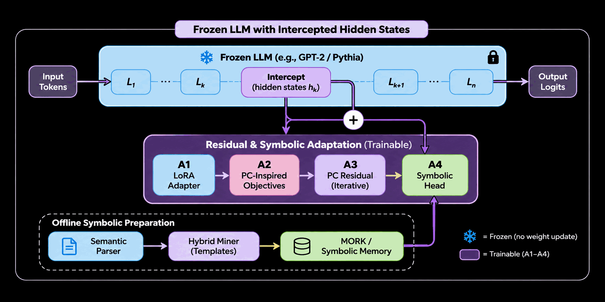

# Neuro-Symbolic LLM

This project explores a neuro-symbolic architecture that combines **pretrained language models, predictive coding (PC), and symbolic reasoning**. Rather than training an entire language model using predictive coding from scratch, the approach builds on an existing pretrained LLM whose parameters remain frozen, introducing trainable residual components that operate on its intermediate hidden-state representations.

The architecture uses hidden-state interception to connect the frozen language model with a trainable adaptation layer. This layer explores different approaches to residual learning, progressing from ordinary low-rank adapters and PC-inspired objectives to true predictive-coding inference and symbolic integration. The symbolic component connects neural representations to structured knowledge through a semantic parsing and pattern-mining pipeline, with retrieved templates stored in MORK (Hyperon) and made available during runtime.

The overall objective is to investigate whether predictive-coding-based adaptation and explicit symbolic knowledge integration can improve representation organization, continual learning, and the connection between neural computation and symbolic reasoning, while retaining the capabilities of the pretrained language model.

## Architecture



## Components

### Frozen LLM — Base Model

Provides frozen GPT-2/Pythia execution, hidden-state caching, and interception hooks for injecting trainable residual modifications.

[See more](frozenllm/README.md)

### A1 — Ordinary Residual Adapter

Implements a low-rank hidden-state residual baseline trained using ordinary backpropagation, without modifying the pretrained model parameters.

[See more](stages/stage_A/a1/README.md)

### A2 — PC-Inspired Residual Objectives

Introduces predictive-coding-inspired auxiliary objectives, including hidden-state prediction, contrastive future prediction, and stability losses.

[See more](stages/stage_A/a2/README_A2.md)

### A3 — Predictive-Coding Residual

Introduces iterative latent-state inference and energy minimization using FabricPC to learn residual corrections.

[See more](stages/stage_A/a3/README_A3.md)

### A4 — Symbolic Head

Connects neural representations with structured symbolic knowledge through template retrieval and symbolic attention, backed by MORK.

### Semantic Parser

Provides teacher–student semantic extraction, validation, MeTTa representation, and integration with the hybrid miner for symbolic knowledge preparation.

[See more](parser/README.md)

## Installation

### Requirements

- Python 3.11 or newer (Python 3.12 recommended).
- NVIDIA GPU and compatible CUDA/JAX environment for GPU experiments.

### Environment Setup

Using Conda:

```bash
conda create -n neuro-symbolic-llm python=3.12 -y
conda activate neuro-symbolic-llm
```

Alternatively, using a Python virtual environment:

```bash
python -m venv .venv
source .venv/bin/activate
```

### Install Project Dependencies

Install the project and its declared dependencies:

```bash
python -m pip install --upgrade pip
pip install -e .
```

## Local Models — Ollama

The semantic parser supports local LLMs through Ollama.

For Ollama installation, server startup, model downloads, and backend configuration, see the [Semantic Parser documentation](parser/README.md).

## Running Experiments

Run commands from the repository root after activating the environment.

### 1. Offline Preparation — A4 Symbolic Pipeline

Run the end-to-end offline preparation workflow:

```bash
bash scripts/run_offline_pipeline.sh
```

For pipeline configuration, model setup, and detailed execution instructions, see the [Semantic Parser documentation](parser/README.md).

### 2. Stage A Experiments

Each neural adaptation stage can be executed independently.

**A1 — Ordinary Residual Adapter**

```bash
python experiments/run_stage_a1.py \
    --config configs/stage_A/a1_lora_baseline.yaml
```

**A2 — PC-Inspired Objectives**

```bash
python experiments/run_stage_a2.py \
    --config configs/stage_A/a2_pc_inspired.yaml
```

**A3 — Predictive-Coding Residual**

```bash
python experiments/run_stage_a3.py \
    --config configs/stage_A/a3_hybrid_pc.yaml
```

To compare different inference-step counts:

```bash
python experiments/run_stage_a3.py --K 1 2 4 8
```

**A4 — Symbolic Head**

A4 builds on the offline symbolic preparation pipeline and integrates retrieved templates into the neural architecture. Its standalone experiment runner and end-to-end training workflow are under development.

## Configuration and Results

- `configs/stage_A/` — Stage-specific experiment configurations.
- `configs/parser_config/` — Semantic parser and model backend configurations.
- `experiments/` — Experiment entry points for A1–A4.
- `runs/` — Training outputs, checkpoints, metrics, and experiment summaries.

Refer to each component's documentation for detailed configuration options, training procedures, evaluation, and implementation details.
