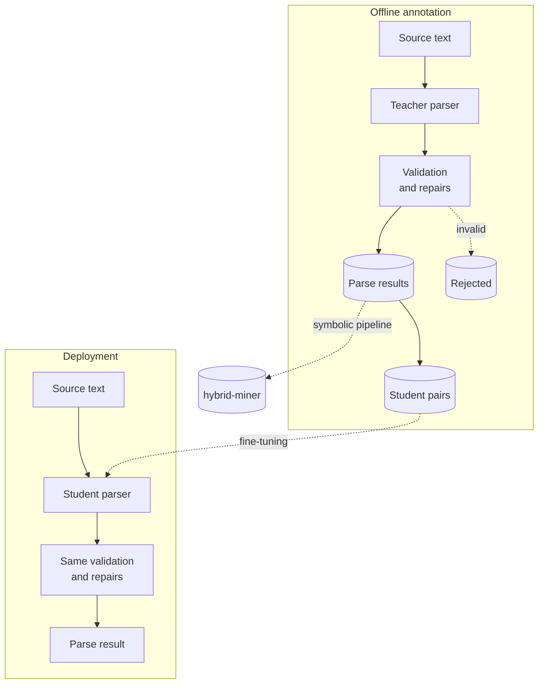
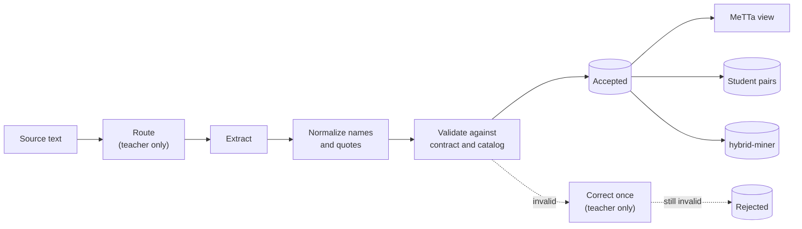

# Semantic parser

The semantic parser turns natural-language text into a validated,
source-grounded semantic structure. Each result can also be rendered as a
deterministic [MeTTa view](#metta-view) and converted into documents for
[hybrid-miner](https://github.com/iCog-Labs-Dev/hybrid-miner) by the
[symbolic pipeline](../symbolic_pipeline/README.md).

## Overview

```text
Input:        The Supplier shall deliver the Goods.
Model output: {"entities": [{"id": "supplier", "entity_type": "Entity",
                             "mention": {"text": "Supplier"}}, ...],
               "assertions": [{"predicate": "Evaluation", "relation": "deliver",
                               "modality": "obligation", "arguments": [...],
                               "evidence": [{"text": "The Supplier shall deliver the Goods"}]}]}
MeTTa view:   (Obligation (Evaluation deliver (List supplier goods)))
```

Two parsers share one pipeline and return the same `SemanticParseResult`:

- `ReferenceSemanticParser` uses a large teacher model for offline annotation.
- `DistilledSemanticParser` uses a small fine-tuned student model for
  deployment.

## Quick start

```bash
python -m pip install -e ".[miner,ollama]"
ollama serve          # in another terminal; the default model runs on Ollama
python -m parser.semantic parse "The Supplier shall deliver the Goods." --format metta
```

To use another model, see [Model backend](#model-backend).

## Architecture

### Teacher–student flow



### Parser pipeline



The teacher makes up to three model calls per document:

1. **Route.** Decide whether the text needs discourse-aware extraction
   ("but", "because", "although").
2. **Extract.** Send the general prompt, alone or with the discourse extension.
3. **Correct.** On a validation error, send the errors and the previous answer
   once. A second failure rejects the document.

The student makes one call, with no routing and no correction.

The model writes only the extraction. Code adds document IDs, provenance, and
character offsets, so the model never produces numbers it cannot see.

### Output contract

A `SemanticParseResult` holds the source document, the provenance, and the
extraction:

- **Entities**: each has a document-local `id`, an ontology type, and a
  `mention` quoted from the source.
- **Assertions**: a catalog predicate such as `LocatedIn`, or `Evaluation` with
  a `relation` when no catalog predicate fits. Each carries polarity,
  factuality, modality, confidence, and quoted evidence.
- **Rules**: if-then rules, either `universal` (with variables such as
  `$party`) or `specific` (about entities in the text).

The relation vocabulary comes from the versioned ontology modules in
[`ontology/`](ontology/), selected by a bundle manifest.

### Repairs

Some model mistakes are fixed instead of rejecting the whole document. Every
repair is recorded in `provenance.repairs`, so its rate can be measured.

| Kind | What the parser did |
| --- | --- |
| `predicate_contract` | Cleared a stray `relation` or `fallback` on a catalog predicate |
| `pronoun_kind` | Cleared a pronoun used as an entity kind |
| `pronoun_in_rule` | Bound an unresolved pronoun in a universal rule to its only variable |
| `unresolved_pronoun` | Recorded a pronoun the model left unresolved |
| `rule_duplicate` | Removed a standalone copy of a rule part |
| `quote_case` | Restored the source spelling of a quote that differed only by letter case |

### MeTTa view

The MeTTa view is rendered deterministically from the JSON result. It is not a
second model output.

```text
The Supplier shall not deliver the Goods.
(Obligation (Not (Evaluation deliver (List supplier goods))))
```

### Miner adapter

The [symbolic pipeline](../symbolic_pipeline/README.md) converts parser results
into hybrid-miner documents. Negation and modality become signed and modal
facts, so neither looks like something that happened. See its
[conversion rules](../symbolic_pipeline/README.md#conversion-rules).

## Model backend

The parser reaches every model through one interface, so the model is chosen
in configuration, not in code. All profiles are in
[`configs/parser_config/model_backend.yaml`](../configs/parser_config/model_backend.yaml):

```yaml
active: ollama_catalog      # the default profile

profiles:
  ollama_catalog:           # one entry per model
    provider: ollama
    model: ...
  gemini:
    provider: gemini
    model: ...
```

**Default.** The profile named by `active`: a local Ollama model. Start the
server with `ollama serve` and download the model once with
`ollama pull MODEL`.

**Other models to choose.** The file has a ready profile for each provider:

- `openai`: OpenAI (API key in `.env`)
- `anthropic`: Anthropic (API key in `.env`)
- `gemini`: Google Gemini (API key in `.env`)
- `openai_compatible`: vLLM, Together, Groq, or any compatible server (server
  URL in `.env`)
- `ollama` and the other `ollama_*` profiles: local Ollama models
  (`ollama serve`)
- `transformers_local`: a local Hugging Face model

Install the provider's extra (for example `pip install -e ".[gemini]"`) and
copy [`.env.example`](../.env.example) to `.env` for the keys. Then pick the
profile for one command, or change `active` to make it the default:

```bash
python -m parser.semantic --profile gemini parse "A bird can fly."
```

## Usage

Parse one sentence:

```bash
python -m parser.semantic parse "A bird can fly." --format metta
```

Export a file of sentences:

```bash
python -m parser.semantic export-documents --input data/source.jsonl --output data/results.jsonl
```

Run the teacher–student chain end to end (extraction, splits, student
training, evaluation):

```bash
python -m parser.semantic e2e --input data/source.jsonl --output-dir models/semantic_document_parser
```

Convert the results for the miner:

```bash
python -m symbolic_pipeline --input data/results.jsonl --output data/documents.jsonl
```

Every command has `--help` for its options.

## Testing

```bash
python -m pytest tests/unit tests/integration -q
```
