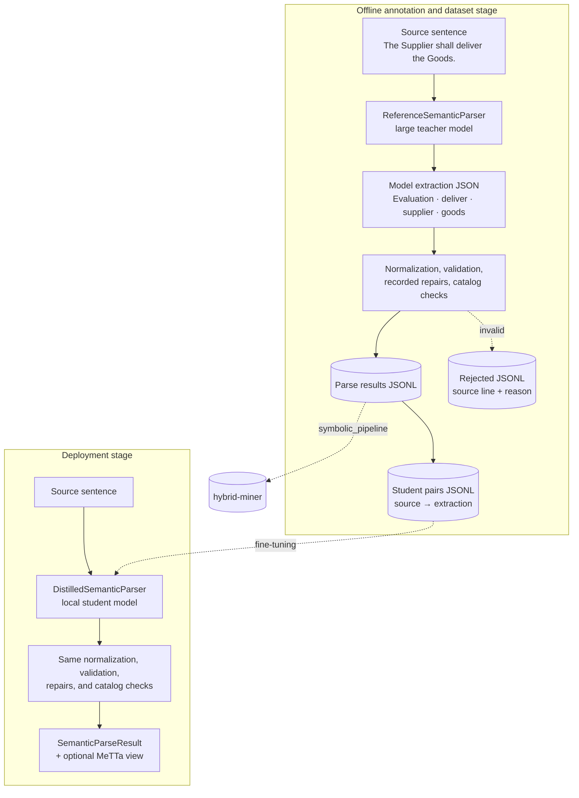
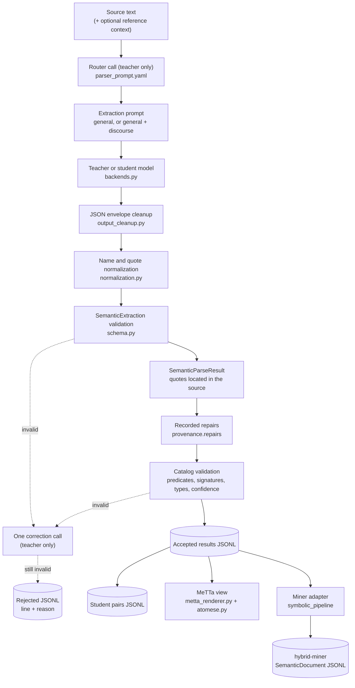
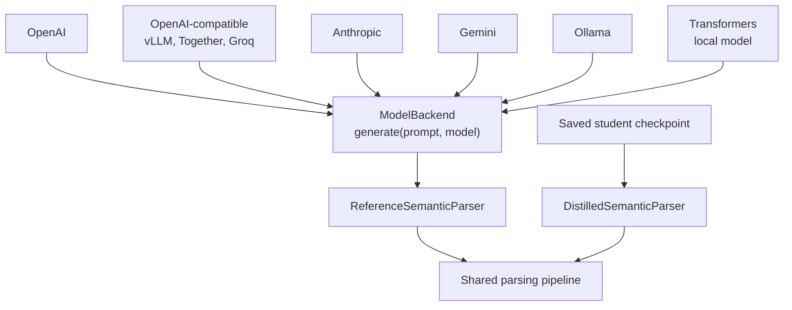

# Semantic parser

The semantic parser turns natural-language text into a validated,
source-grounded semantic structure. Each result can also be rendered as a
deterministic [MeTTa view](#metta-view) and converted into documents for
[hybrid-miner](https://github.com/iCog-Labs-Dev/hybrid-miner) by the
[symbolic pipeline](../symbolic_pipeline/README.md).

## Overview

```text
Input:        The Supplier shall deliver the Goods.
Model output: {"entities": [{"id": "supplier", "kind": "supplier",
                             "entity_type": "Entity", "mention": {"text": "Supplier"}}, ...],
               "assertions": [{"predicate": "Evaluation", "relation": "deliver",
                               "modality": "obligation", "arguments": [...],
                               "evidence": [{"text": "The Supplier shall deliver the Goods"}], ...}]}
MeTTa view:   (Obligation (Evaluation deliver (List supplier goods)))
```

Two parsers share one pipeline:

- [`ReferenceSemanticParser`](semantic/semantic_parser.py) uses a large
  teacher model for offline annotation.
- [`DistilledSemanticParser`](semantic/semantic_parser.py) uses a fine-tuned
  local student model (1B–3B parameters) for deployment.

Both return a `SemanticParseResult` under semantic contract `1.0.0`. A result
holds the source document, the parse provenance, and the validated extraction.

## Architecture

### Teacher–student flow



### Parser pipeline



The teacher makes up to three model calls per document:

1. **Route.** The router decides whether the text needs discourse-aware
   extraction (for example, "but", "because", "although").
2. **Extract.** The general prompt is sent alone, or with the discourse
   extension inserted before the source input.
3. **Correct.** If validation fails, the teacher receives the errors and its
   previous JSON once. A second failure rejects the document.

The student makes exactly one call, with no routing and no correction. It
predicts general and discourse semantics in a single extraction.

The model writes only the extraction. Deterministic code adds document IDs,
provenance, and character offsets, so the model never has to produce numbers
it cannot see.

### Output contract

[`schema.py`](semantic/schema.py) defines the parser's own types and does not
depend on the hybrid miner.

| Type | Meaning |
| --- | --- |
| `SemanticEntity` | One thing mentioned in the document: a document-local `id` (`supplier`), its ontology `entity_type` (`Entity`), the `kind` that names it (`supplier`), and its `mention` quoted from the source. |
| `SemanticAssertion` | A catalog predicate such as `LocatedIn`, or `Evaluation` with a `relation` such as `deliver` when no catalog predicate fits. It carries polarity, factuality, modality, confidence, quoted evidence, and alternative readings. |
| `SemanticRule` | An if-then rule, either `universal` (with variables such as `$party`) or `specific` (about entities in the text). Every rule part is hypothetical. |
| `SourceQuote` | Exact words from the source plus an occurrence number. `SemanticParseResult.locate` turns it into character offsets. |

The relation vocabulary comes from the versioned ontology modules in
[`ontology/`](ontology/), selected by the
[bundle manifest](ontology/bundles/semantic-extraction-v1.yaml):
`upper`, `general`, `discourse`, `narrative`, `lexical`, `program`, and
`proof`. [`general.yaml`](ontology/general.yaml), for instance, holds general
relations such as `LocatedIn`, `PartOf`, and `UsedFor`.

### Repairs

Some model mistakes are fixed instead of rejecting the whole document. Every
repair is recorded in `provenance.repairs`, so its rate can be measured.

| Kind | What the parser did |
| --- | --- |
| `predicate_contract` | Cleared a stray `relation` or `fallback` on a catalog predicate. |
| `pronoun_kind` | Cleared a pronoun used as an entity kind (`she`), which would join unrelated documents. |
| `pronoun_in_rule` | Bound an unresolved pronoun in a universal rule to the rule's only variable. |
| `unresolved_pronoun` | Changed nothing; recorded a pronoun the model left unresolved. |
| `rule_duplicate` | Removed a standalone copy of a rule part, which would turn a condition into a fact. |
| `quote_case` | Restored the source's spelling of a quote that differed only by letter case (`students` for `Students`). |

A universal rule whose pronoun could refer to more than one variable is
rejected rather than guessed. A quote with different words, not just a
different letter case, is always rejected.

### MeTTa view

[`metta_renderer.py`](semantic/metta_renderer.py) renders a result
deterministically. It is a view of the JSON result, not a second model output.
Entity IDs become symbols, so two entities never collapse into one name.

```text
Ethiopia is located in Africa.            (LocatedIn ethiopia africa)
The Supplier shall not deliver the Goods. (Obligation (Not (Evaluation deliver (List supplier goods))))
The Buyer may not terminate.              (Not (Permission (Evaluation terminate (List buyer))))
Each Party shall notify if it terminates. (Implies (Evaluation terminate (List $party))
                                                   (Obligation (Evaluation notify (List $party))))
```

Plain MeTTa cannot mark an opinion, a speculation, or a standalone
hypothetical, so the full view refuses them rather than showing them as facts.
The asserted-only view (`--asserted-only`) leaves them out instead, together
with all rules. [`atomese.py`](grammar/atomese.py) validates the output against
the grammar in [`atomese_grammar.yaml`](../configs/parser_config/atomese_grammar.yaml)
and against every catalog relation and its arity.

### Miner adapter

The [symbolic pipeline](../symbolic_pipeline/README.md) is the only code that
converts parser results into hybrid-miner's `SemanticDocument`. An
`Evaluation` becomes an event with role facts, a universal rule becomes a miner
rule with signed literals, and negation and modality become signed and modal
facts, so neither looks like something that happened. Content the miner cannot
express is rejected with a reason. See its
[conversion rules](../symbolic_pipeline/README.md#conversion-rules) for the
full mapping and an example.

The parser never imports hybrid-miner. Both sides load the same
[bundle manifest](ontology/bundles/semantic-extraction-v1.yaml), so they use
one ontology.

### Model backends



The parsers never call a provider SDK directly; they depend only on the
`ModelBackend` protocol in [`backends.py`](semantic/backends.py). A backend
that stops at its output-token limit raises an error instead of returning
truncated JSON, and the export stops with that reason. In that case, raise the
profile's output budget and run the export again with new output paths:
`--resume` only continues a run whose settings are unchanged.

### Component source map

| Component | Implementation |
| --- | --- |
| Model backends and `ModelBackend` | [`backends.py`](semantic/backends.py), [`model_config.py`](semantic/model_config.py) |
| Reference and distilled parsers, routing, repairs, catalog validation | [`semantic_parser.py`](semantic/semantic_parser.py) |
| Prompt construction | [`catalog_prompt.py`](semantic/catalog_prompt.py), [`general_prompt.yaml`](../configs/parser_config/general_prompt.yaml), [`discourse_prompt.yaml`](../configs/parser_config/discourse_prompt.yaml), [`parser_prompt.yaml`](../configs/parser_config/parser_prompt.yaml) |
| Output contract | [`schema.py`](semantic/schema.py) |
| Name and quote normalization | [`normalization.py`](semantic/normalization.py) |
| Response-envelope cleanup | [`output_cleanup.py`](semantic/output_cleanup.py) |
| Ontology catalog and bundle manifest | [`catalog.py`](ontology/catalog.py) |
| MeTTa rendering and validation | [`metta_renderer.py`](semantic/metta_renderer.py), [`atomese.py`](grammar/atomese.py) |
| Checkpointed export | [`catalog_document_export.py`](semantic/catalog_document_export.py) |
| Student pairs and checkpoints | [`catalog_student.py`](semantic/catalog_student.py), [`dataset.py`](semantic/dataset.py) |
| Student prompt and training | [`student_prompt.py`](student/student_prompt.py), [`train.py`](student/train.py) |
| Command-line interface | [`cli.py`](semantic/cli.py) |
| Miner adapter and miner bundle ([README](../symbolic_pipeline/README.md)) | [`miner_adapter.py`](../symbolic_pipeline/miner_adapter.py), [`miner_bundle.py`](../symbolic_pipeline/miner_bundle.py), [`document_export.py`](../symbolic_pipeline/document_export.py) |

## Installation and configuration

Install the project with the extras you need. The parser itself does not need
the `miner` extra; `symbolic_pipeline` does.

```bash
python -m pip install -e ".[miner,ollama]"
```

Copy [`.env.example`](../.env.example) to `.env` and add only the credentials
you use. Model selection belongs in
[`model_backend.yaml`](../configs/parser_config/model_backend.yaml). The
`active` profile is the default; `--profile`, placed before the subcommand,
overrides it for one command. A profile names the environment variables it
reads, so the YAML file never contains secrets.

| Provider | Profile settings |
| --- | --- |
| `openai` | `model`, `api_key_env`, `max_output_tokens` |
| `anthropic` | `model`, `api_key_env`, `max_tokens` |
| `gemini` | `model`, `api_key_env`, `max_output_tokens` |
| `openai-compatible` | `model` or `model_env`, `base_url_env`, optional `api_key_env`, `max_output_tokens` |
| `ollama` | `model`, optional `host_env`, `max_output_tokens`, `num_ctx`, `think`, `temperature`, `seed` |
| `transformers-local` | `model` (Hub ID or local path), optional `hf_token_env`, `max_new_tokens`, `add_special_tokens`; a student profile also sets `role: student` and optionally `device` |

Reasoning and thinking models count their reasoning tokens against the output
budget, so give them a document-sized budget. The general extraction prompt is
about 12,000 tokens, and about 17,000 with the discourse extension. An Ollama
profile must therefore set `num_ctx` to cover the prompt plus the output:
Ollama's default window of 4,096 tokens silently drops the start of a longer
prompt.

The local Ollama profile used for catalog extraction:

```yaml
active: ollama_catalog

profiles:
  ollama_catalog:
    provider: ollama
    model: qwen3:8b
    host_env: OLLAMA_HOST
    max_output_tokens: 3072
    num_ctx: 24576
    think: false
    temperature: 0.0
```

Start the Ollama server in another terminal:

```bash
ollama serve
```

For a remote Ollama server reached through an SSH tunnel, keep the tunnel open
and set `OLLAMA_HOST` in `.env`, for example
`OLLAMA_HOST=http://127.0.0.1:11435`. Never commit credentials or connection
details.

## Usage

### Parse a sentence

```bash
python -m parser.semantic --profile ollama_catalog parse "A bird can fly."
python -m parser.semantic --profile ollama_catalog parse "It released a new phone." \
  --context "Apple is a technology company."
python -m parser.semantic --profile ollama_catalog parse "A bird can fly." --format metta
```

The context helps resolve references but is never quoted, so it cannot
contribute facts of its own.

In Python, use the factory rather than choosing provider classes manually:

```python
from parser.semantic import build_reference_semantic_parser
from parser.semantic.metta_renderer import render_metta

parser = build_reference_semantic_parser(profile_name="ollama_catalog")
result = parser.parse("Ethiopia is located in Africa.")
print(result.model_dump_json())
print(render_metta(result))  # ['(LocatedIn ethiopia africa)']
```

Every command accepts `--ontology-bundle PATH` to use another manifest, or
`--ontology-module NAME` (repeatable) to select individual modules.

### Export results

```bash
python -m parser.semantic --profile ollama_catalog export-documents \
  --input data/source.jsonl \
  --output data/results.jsonl \
  --student-pairs-output data/pairs.jsonl \
  --include-metta
```

The input can be UTF-8 text with one sentence per line, a manifest such as
`{"text": "Mira left.", "source_dataset": "pilot", "source_domain": "narrative"}`,
or identified records such as
`{"document_id": "doc-1", "corpus_id": "pilot", "source_text": "Mira left."}`.
`build-dataset` is an alias for the same command.

| Option | Behavior |
| --- | --- |
| `--rejected-output` | Defaults to `<output-stem>.rejected.jsonl`. Each line keeps the source line and the reason. |
| `--metadata-output` | Defaults to `<output-stem>.metadata.jsonl`. Binds dataset, domain, and the optional MeTTa view to each document's identity and source fingerprint. |
| `--progress-every` | Checkpoints progress every 100 records by default. After an interruption, repeat the same command with `--resume`; the source, model, prompt, and options must match before generation continues. |
| `--require-structured-output` | Refuses a backend without JSON-schema decoding (Ollama supports it). |

### Convert results for the miner

```bash
python -m symbolic_pipeline --input data/results.jsonl --output data/documents.jsonl \
  --bundle-output data/ontology.bundle.json
```

`--bundle-output` also writes the ontology bundle the documents were checked
against. Rejected results go to `<output-stem>.rejected.jsonl`. For all
options, exit codes, and `--skip-unsupported-rules`, see the
[symbolic pipeline usage](../symbolic_pipeline/README.md#usage).

## Student data, training and inference

A student pair holds the source text and, as its label, the teacher's final
`SemanticExtraction`. Provenance stays outside the label, and each pair records
the contract, prompt fingerprint, and ontology versions it was made with.

```bash
python -m parser.semantic convert-to-pairs --input data/results.jsonl --output data/pairs.jsonl
python -m parser.semantic split-pairs --input data/pairs.jsonl --output-dir data/splits
python -m parser.semantic train-student --train-file data/splits/train.jsonl \
  --val-file data/splits/validation.jsonl --method lora
python -m parser.semantic distill --model-dir models/semantic_document_parser "Mira left."
```

`split-pairs` writes `train.jsonl`, `validation.jsonl`, and `test.jsonl`
(80/10/10 by default) with no source text shared between splits.
[`student_config.yaml`](../configs/parser_config/student_config.yaml) sets the
base model (`Qwen/Qwen2.5-1.5B-Instruct`), the contract version, the bundle,
and the training and LoRA settings. A checkpoint is loaded only if its
contract, prompt fingerprint, and ontology versions match the active ones.

`e2e` runs the whole chain in one run directory: teacher extraction,
source-disjoint splits, student training, and evaluation on the held-out test
split.

```bash
python -m parser.semantic --profile ollama_catalog e2e --input data/source.jsonl \
  --output-dir models/semantic_document_parser --method lora --min-acceptance 0.8
```

| Option | Behavior |
| --- | --- |
| `--min-acceptance` | Stops the run when too few sources are accepted. |
| `--resume` | Continues an interrupted extraction. |
| `--force` | Starts a fresh child run instead of overwriting artifacts. |
| `--skip-training` | Evaluates an existing compatible checkpoint. |

The exact-match score compares extractions field by field, so it is sensitive
to IDs and ordering. It is not a semantic-equivalence score.

## Repository structure

```text
configs/parser_config/
├── atomese_grammar.yaml            # MeTTa grammar words and operators
├── catalog_document_examples.jsonl # worked extraction examples
├── discourse_prompt.yaml           # discourse extension of the extraction prompt
├── general_prompt.yaml             # general extraction prompt
├── model_backend.yaml              # provider and model profiles
├── parser_prompt.yaml              # router prompt (general or discourse)
├── pilot_corpus.yaml               # pilot corpus definition
└── student_config.yaml             # student base model and training settings
parser/
├── grammar/atomese.py              # Atomese model, parser, and validation
├── ontology/                       # versioned relation catalogs and bundle manifest
├── semantic/                       # parsers, contract, export, CLI
└── student/                        # student prompt and training
symbolic_pipeline/                  # parser-to-miner adapter
tests/                              # offline unit and integration tests
```

Related documentation: [project overview](../README.md) ·
[symbolic pipeline](../symbolic_pipeline/README.md) ·
[hybrid-miner](https://github.com/iCog-Labs-Dev/hybrid-miner).

## Testing

The tests check deterministic behavior without calling a model provider:
validation, repairs, normalization, routing and prompt construction, MeTTa
rendering, Atomese parsing, export and resume, student pairs, model-profile
selection, and the miner adapter.

```bash
python -m pytest tests/unit tests/integration -q
```

Two miner-adapter tests also run the documents through PeTTa admission. They
are skipped unless both PeTTa and hyperon-miner are available:

```bash
export PETTA_ROOT=/path/to/PeTTa
export MINER_ROOT=/path/to/hybrid-miner/hyperon-miner
python -m pytest tests/unit/test_miner_adapter.py -q -rs
```

Do not replace these tests with live API tests. Test provider integrations
separately with a small opt-in run, because they need credentials and network
access and may incur costs. Passing tests show contract compliance, not
extraction quality; to judge quality, audit the rejection reasons and compare
results with their source sentences.

## Implementation status

**Implemented:**
- Semantic contract `1.0.0` with catalog validation and recorded repairs.
- Router-based general and discourse extraction, with one teacher correction
  attempt.
- Deterministic MeTTa rendering, validated against the Atomese grammar.
- Configurable provider backends.
- Checkpointed export with resume.
- Student data, training, and inference.
- The `symbolic_pipeline` adapter to hybrid-miner, including universal rules,
  modality, and negated events.

**Known limitations:**
- The miner rule contract cannot hold modality, so a universal rule with an
  obligation or permission is rejected, or left out with
  `--skip-unsupported-rules`.
- The contract has no form for "does not have to" (no obligation). The prompt
  encodes it as a speculative action marked `optional` rather than as a
  prohibition.
- The student evaluation uses exact match, which does not credit equivalent
  extractions with different IDs or ordering.
