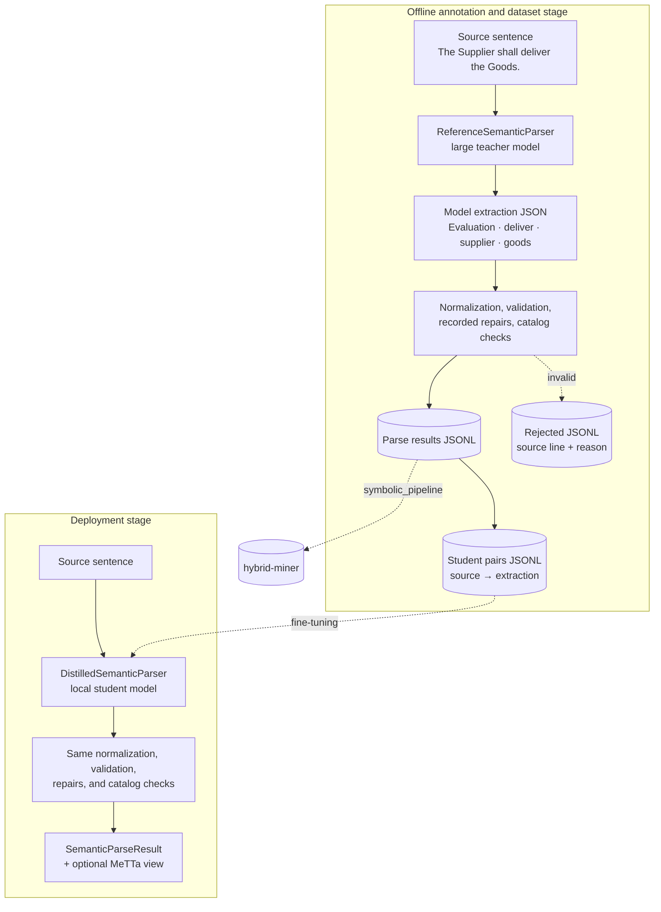
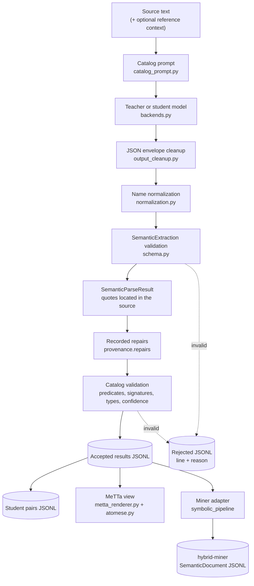
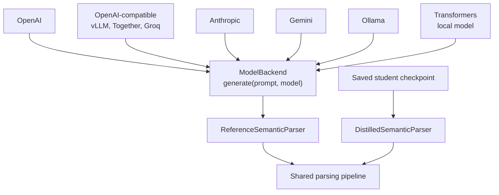

# Semantic parser

Natural-language text to validated, source-grounded semantic structure, with a
deterministic MeTTa view and an adapter to the hybrid miner.

## Overview

```text
Input:        The Supplier shall deliver the Goods.
Model output: {"entities": [{"id": "supplier", "kind": "supplier",
                             "entity_type": "Entity", "mention": {"text": "Supplier"}}, ...],
               "assertions": [{"predicate": "Evaluation", "relation": "deliver",
                               "modality": "obligation", "arguments": [...],
                               "evidence": [{"text": "The Supplier shall deliver the Goods"}], ...}]}
MeTTa view:   (Obligation (Evaluation deliver (List supplier goods)))
```

[`ReferenceSemanticParser`](semantic/semantic_parser.py) uses a large teacher
model for offline annotation. [`DistilledSemanticParser`](semantic/semantic_parser.py)
uses a fine-tuned local 1B–3B student for deployment. Both run the same pipeline
and return a `SemanticParseResult` (semantic contract `2.0.0`): the source
document, the parse provenance, and the validated extraction.

## Architecture

### End-to-end teacher–student flow



### Parser pipeline



The model writes only the extraction. Deterministic code adds document IDs,
provenance, and character offsets, so the model never produces numbers it
cannot see.

### Output contract

[`schema.py`](semantic/schema.py) defines the parser's own types; it does not
depend on the hybrid miner.

- `SemanticEntity`: one thing mentioned in the document, with a document-local
  `id` (`supplier`), its ontology `entity_type` (`Entity`), the `kind` that
  names it (`supplier`), and its `mention` quoted from the source.
- `SemanticAssertion`: a catalog predicate such as `LocatedIn`, or
  `Evaluation` with a `relation` such as `deliver` when no catalog predicate
  fits. It carries polarity, factuality, modality, confidence, quoted evidence,
  and alternative readings.
- `SemanticRule`: an if-then rule, `universal` (with variables such as
  `$party`) or `specific` (about entities in the text). Every rule part is
  hypothetical.
- `SourceQuote`: exact words from the source plus an occurrence number;
  `SemanticParseResult.locate` turns it into character offsets.

The relation vocabulary comes from the versioned ontology modules in
[`ontology/`](ontology/), selected by the
[bundle manifest](ontology/bundles/semantic-extraction-v2.yaml).

Bundle version 2 corrects the concession/expectation-defeat signatures from
the Hybrid Pattern Mining paper, section 8.2 (printed pages 29–30): `Defeats`
starts with a `Clause`, `DiscourseFocus` targets that clause, and `Content`
accepts an expected `Proposition` as its first argument. The other modules,
including `general-v1`, remain selected. Existing parser results and student
checkpoints retain their recorded ontology versions; do not relabel old data
as the new bundle or bypass checkpoint compatibility checks.
[`general.yaml`](ontology/general.yaml) holds the general relations such as
`LocatedIn`, `PartOf`, and `UsedFor`.

### Repairs

Some model mistakes are fixed instead of rejecting the whole document. Every
repair is written to `provenance.repairs`, so its rate can be measured:

| Kind | What the parser did |
| --- | --- |
| `predicate_contract` | Cleared a stray `relation` or `fallback` on a catalog predicate |
| `pronoun_kind` | Cleared a pronoun used as an entity kind (`she`), which would join unrelated documents |
| `pronoun_in_rule` | Bound an unresolved pronoun in a universal rule to the rule's only variable |
| `unresolved_pronoun` | Changed nothing; recorded a pronoun the model left unresolved |
| `rule_duplicate` | Removed a standalone copy of a rule part, which would turn a condition into a fact |

A universal rule whose pronoun could refer to more than one variable is
rejected rather than guessed.

### MeTTa view

[`metta_renderer.py`](semantic/metta_renderer.py) renders a result
deterministically; it is a view of the JSON result, not a second model output.
Entity IDs become symbols, so two entities never collapse into one name.

```text
Ethiopia is located in Africa.            (LocatedIn ethiopia africa)
The Supplier shall not deliver the Goods. (Obligation (Not (Evaluation deliver (List supplier goods))))
The Buyer may not terminate.              (Not (Permission (Evaluation terminate (List buyer))))
Each Party shall notify if it terminates. (Implies (Evaluation terminate (List $party))
                                                   (Obligation (Evaluation notify (List $party))))
```

Plain MeTTa cannot show an opinion, a speculation, or a standalone hypothetical,
so these are refused rather than shown as facts; the asserted-only view leaves
them out instead. [`atomese.py`](grammar/atomese.py) validates the output
against the grammar in
[`atomese_grammar.yaml`](../configs/parser_config/atomese_grammar.yaml)
plus every catalog relation with its arity.

### Miner adapter

[`symbolic_pipeline`](../symbolic_pipeline/miner_adapter.py) is the only code
that converts parser results into the hybrid miner's `SemanticDocument`. An
`Evaluation` becomes an event with role facts, a specific rule becomes facts
conditional on a clause, and each entity kind becomes a kind fact. Content the
miner contract cannot express is rejected with a reason.

The parser never imports hybrid-miner. It loads the modules a bundle manifest
selects with [`catalog.py`](ontology/catalog.py);
[`miner_bundle.py`](../symbolic_pipeline/miner_bundle.py) builds the miner's
`OntologyBundle` from the same manifest, so both sides use one ontology.

### Model backends



The parsers never call a provider SDK directly; they depend only on the
`ModelBackend` protocol in [`backends.py`](semantic/backends.py). A backend
that stops at its output-token limit raises an error instead of returning
truncated JSON, and the export stops with that reason. Raise the profile's
budget and run the export again with new output paths: `--resume` only
continues a run whose settings are unchanged.

### Component source map

| Component | Implementation |
| --- | --- |
| Model backends and `ModelBackend` | [`backends.py`](semantic/backends.py), [`model_config.py`](semantic/model_config.py) |
| Reference and distilled parsers, repairs, catalog validation | [`semantic_parser.py`](semantic/semantic_parser.py) |
| Prompt construction | [`catalog_prompt.py`](semantic/catalog_prompt.py), [`catalog_document_prompt.yaml`](../configs/parser_config/catalog_document_prompt.yaml) |
| Output contract | [`schema.py`](semantic/schema.py) |
| Name normalization | [`normalization.py`](semantic/normalization.py) |
| Response-envelope cleanup | [`output_cleanup.py`](semantic/output_cleanup.py) |
| Ontology catalog and bundle manifest | [`catalog.py`](ontology/catalog.py) |
| MeTTa rendering and validation | [`metta_renderer.py`](semantic/metta_renderer.py), [`atomese.py`](grammar/atomese.py) |
| Checkpointed export | [`catalog_document_export.py`](semantic/catalog_document_export.py) |
| Student pairs and checkpoints | [`catalog_student.py`](semantic/catalog_student.py), [`dataset.py`](semantic/dataset.py) |
| Command-line interface | [`cli.py`](semantic/cli.py) |
| Miner adapter and miner bundle | [`miner_adapter.py`](../symbolic_pipeline/miner_adapter.py), [`miner_bundle.py`](../symbolic_pipeline/miner_bundle.py), [`document_export.py`](../symbolic_pipeline/document_export.py) |

## Model configuration and running

Copy [`.env.example`](../.env.example) to `.env` and add only the credentials
you use. Model selection belongs in
[`model_backend.yaml`](../configs/parser_config/model_backend.yaml); the active
profile is the default, and `--profile` (placed before the subcommand)
overrides it for one command. A profile names the environment variables it
reads, so the YAML never contains secrets:

| Provider | Profile settings |
| --- | --- |
| `openai` | `model`, `api_key_env`, `max_output_tokens` |
| `anthropic` | `model`, `api_key_env`, `max_tokens` |
| `gemini` | `model`, `api_key_env`, `max_output_tokens` |
| `openai-compatible` | `model` or `model_env`, `base_url_env`, optional `api_key_env`, `max_output_tokens` |
| `ollama` | `model`, optional `host_env`, `max_output_tokens`, `num_ctx`, `think`, `temperature`, `seed` |
| `transformers-local` | `model` (Hub ID or local path), optional `hf_token_env`, `max_new_tokens`, `add_special_tokens`; a student profile also sets `role: student` and optionally `device` |

Reasoning and thinking models count their reasoning tokens against the output
budget, so give them a document-sized budget. The catalog prompt is about
12,000 tokens, so an Ollama profile sets `num_ctx` to cover the prompt plus the
output: Ollama's default window (4,096 tokens) silently drops the start of a
longer prompt.

For example, the local Ollama profile used for catalog extraction is:

```yaml
active: ollama_catalog

profiles:
  ollama_catalog:
    provider: ollama
    model: qwen3:8b
    host_env: OLLAMA_HOST
    max_output_tokens: 3072
    num_ctx: 24576
    think: false
    temperature: 0.0
```

Install the project with the extras you need (the parser itself needs no
`miner` extra; `symbolic_pipeline` does) and start the Ollama server in
another terminal:

```bash
python -m pip install -e ".[miner,ollama]"
ollama serve
```

For a remote Ollama server reached through an SSH tunnel, keep the tunnel open
and point `OLLAMA_HOST` at it, for example `OLLAMA_HOST=http://127.0.0.1:11435`
in `.env`. Never commit credentials or connection details.

Parse one sentence, optionally with reference-only context:

```bash
python -m parser.semantic --profile ollama_catalog parse "A bird can fly."
python -m parser.semantic --profile ollama_catalog parse "It released a new phone." \
  --context "Apple is a technology company."
python -m parser.semantic --profile ollama_catalog parse "A bird can fly." --format metta
```

The context helps resolve references but is never quoted, so it cannot add
facts of its own.

In Python, use the factory instead of choosing provider classes manually:

```python
from parser.semantic import build_reference_semantic_parser
from parser.semantic.metta_renderer import render_metta

parser = build_reference_semantic_parser(profile_name="ollama_catalog")
result = parser.parse("Ethiopia is located in Africa.")
print(result.model_dump_json())
print(render_metta(result))  # ['(LocatedIn ethiopia africa)']
```

### Export results

```bash
python -m parser.semantic --profile ollama_catalog export-documents \
  --input data/source.jsonl \
  --output data/results.jsonl \
  --student-pairs-output data/pairs.jsonl \
  --include-metta
```

Accepted inputs are UTF-8 text with one sentence per line, a manifest such as
`{"text": "Mira left.", "source_dataset": "pilot", "source_domain": "narrative"}`,
or identified records such as
`{"document_id": "doc-1", "corpus_id": "pilot", "source_text": "Mira left."}`.
`build-dataset` is another name for the same command.

- `--rejected-output` defaults to `<output-stem>.rejected.jsonl`; each line
  keeps the source line and the reason.
- `--metadata-output` defaults to `<output-stem>.metadata.jsonl`. It binds
  dataset, domain, and the optional MeTTa view to each document's identity and
  source fingerprint.
- Progress is checkpointed every 100 records (`--progress-every`). After an
  interruption, repeat the same command with `--resume`; the source, model,
  prompt, and options must match before generation continues.
- `--require-structured-output` refuses a backend without JSON-schema decoding
  (Ollama supports it).

Convert the results for the miner, and write the ontology bundle the
documents were checked against:

```bash
python -m symbolic_pipeline --input data/results.jsonl --output data/documents.jsonl \
  --bundle-output data/ontology.bundle.json
```

## Student data, training and inference

A student pair holds the source text and, as its label, the teacher's final
`SemanticExtraction`. Provenance stays outside the label, and each pair pins the
contract, prompt fingerprint, and ontology versions it was made with.

```bash
python -m parser.semantic convert-to-pairs --input data/results.jsonl --output data/pairs.jsonl
python -m parser.semantic split-pairs --input data/pairs.jsonl --output-dir data/splits
python -m parser.semantic train-student --train-file data/splits/train.jsonl \
  --val-file data/splits/validation.jsonl --method lora
python -m parser.semantic distill --model-dir models/semantic_document_parser "Mira left."
```

[`student_config.yaml`](../configs/parser_config/student_config.yaml) selects
the contract version and bundle. A checkpoint is loaded only if its contract,
prompt fingerprint, and ontology versions match the active ones.

`e2e` runs the whole chain in one run directory: teacher extraction, splits
without overlapping source text, student training, and evaluation on the
held-out test split.

```bash
python -m parser.semantic --profile ollama_catalog e2e --input data/source.jsonl \
  --output-dir models/semantic_document_parser --method lora --min-acceptance 0.8
```

`--min-acceptance` stops the run when too few sources are accepted, `--resume`
continues an interrupted extraction, `--force` starts a fresh child run instead
of overwriting artifacts, and `--skip-training` evaluates an existing
checkpoint. The exact-match score compares extractions field by field, so it is
sensitive to IDs and order; it is not a semantic-equivalence score.

## Known limitation

The miner adapter does not convert universal rules yet; such a document is
written to the rejected file with its reason.

## Repository structure

```text
configs/parser_config/
├── atomese_grammar.yaml        # MeTTa grammar words and operators
├── catalog_document_prompt.yaml
├── catalog_document_examples.jsonl
├── model_backend.yaml          # provider and model profiles
├── parser_prompt.yaml          # shared extraction guidance
└── student_config.yaml
parser/
├── grammar/atomese.py          # Atomese model, parser, and validation
├── ontology/                   # versioned relation catalogs and bundle manifest
├── semantic/                   # parser, contract, export, CLI
└── student/                    # student prompt and training
symbolic_pipeline/              # parser-to-miner adapter
tests/                          # offline unit and integration tests
```

## Testing

Tests verify deterministic behavior without calling a model provider:
validation, repairs, normalization, MeTTa rendering, Atomese parsing, export
and resume, student pairs, model-profile selection, and the miner adapter.

```bash
python -m pytest tests/unit tests/integration -q
```

Do not replace these with live API tests. Test provider integrations
separately with a small opt-in run, because those need credentials and network
access and may cost money. Passing tests show contract compliance, not
extraction quality: audit rejection reasons and compare results with their
source sentences.

## Current implementation status

Implemented: the contract `2.0.0` output, catalog validation, recorded
repairs, deterministic MeTTa rendering, configurable provider backends,
checkpointed export with resume, student data and training, the
`symbolic_pipeline` adapter to hybrid-miner, and the contract `2.0.0` teacher
prompt with its worked examples. Next: adapter support for universal rules.
