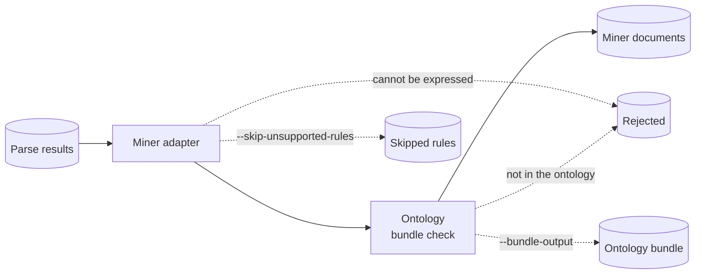

# Symbolic pipeline

The symbolic pipeline converts the [semantic parser's](../parser/README.md)
results into documents for
[hybrid-miner](https://github.com/iCog-Labs-Dev/hybrid-miner). It is the only
code that connects the two projects.



## Usage

```bash
python -m pip install -e ".[miner]"
python -m symbolic_pipeline --input data/results.jsonl --output data/documents.jsonl
```

- Rejected results go to `<output-stem>.rejected.jsonl` with the line number
  and the reason.
- `--bundle-output PATH` also writes the ontology bundle for the miner to load.
- `--skip-unsupported-rules` leaves out a universal rule the miner cannot hold,
  keeps the rest of the document, and lists the rule in
  `<output-stem>.skipped.jsonl`.
- The command never overwrites a file. It exits with `0` when every result was
  converted and `2` when at least one was rejected.

In Python:

```python
from symbolic_pipeline import MinerAdapterError, to_semantic_document

document = to_semantic_document(result)  # result: SemanticParseResult
print(document.canonical_json())
```

## Conversion rules

Each parse result becomes one miner `SemanticDocument`. Quotes become
character spans in the source text.

| Parser content | Miner representation |
| --- | --- |
| `Evaluation` | An event with one relation fact, plus one fact per participant (`Agent`, `Patient`, `Time`, or a provisional `role_<name>` fact) |
| Catalog predicate | A fact with the same predicate and arguments |
| Negative assertion | A negative fact |
| Obligation or permission | A modal fact, so it never looks like something that happened |
| `Negated(e)` on a declared event | `Negated(e)` stays; the facts that say `e` exists become negative |
| Entity kind | A provisional kind fact |
| Specific rule | Hypothetical facts, conditional on a clause entity covering the antecedents |
| Universal rule | A miner rule with signed literals over its variables |

Polarity and modality keep the parser's scope order. "Must not leave" is
`(Obligation (Not ...))` and "may not leave" is `(Not (Permission ...))`; both
are prohibitions.

### Example

"Nora must not leave." becomes an event with a negative obligation on its
relation fact and an `Agent` fact (spans of facts, confidence, and provenance
omitted):

```json
{
  "document_id": "doc-1",
  "source_text": "Nora must not leave.",
  "entities": [
    {"id": "nora", "type": "Entity", "span": {"start": 0, "end": 4}},
    {"id": "event-0", "type": "Event", "span": {"start": 0, "end": 19}}
  ],
  "assertions": [
    {"predicate": "ProvisionalRelation", "provisional_relation_id": "leave",
     "arguments": ["event-0"], "polarity": "negative", "modality": "obligation"},
    {"predicate": "Agent", "arguments": ["event-0", "nora"]}
  ]
}
```

### Rejected content

Content the miner contract cannot express raises `MinerAdapterError`:

- modality inside a universal rule ("Every visitor must sign");
- an `Evaluation` without participants inside a universal rule;
- a negative `Negated` fact, which is a double negation.

With `--skip-unsupported-rules`, the first two leave out only the rule.

## Testing

```bash
python -m pytest tests/unit/test_miner_adapter.py -q
```
