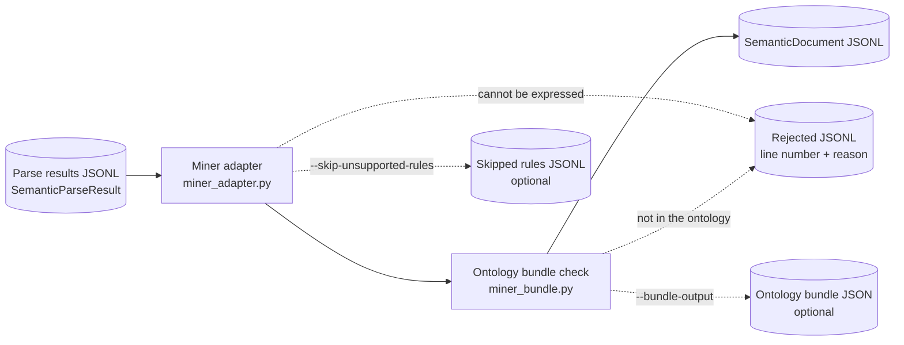

# Symbolic pipeline

The symbolic pipeline converts the [semantic parser's](../parser/README.md)
results into documents for
[hybrid-miner](https://github.com/iCog-Labs-Dev/hybrid-miner). It is the only
code that connects the two projects: the parser never imports hybrid-miner,
and hybrid-miner never reads parser output directly.



## Installation

The pipeline needs the `miner` extra and a hybrid-miner version with signed
negation and modality heads (newer than `v0.1.0`):

```bash
python -m pip install -e ".[miner]"
```

## Usage

```bash
python -m symbolic_pipeline --input data/results.jsonl --output data/documents.jsonl \
  --bundle-output data/ontology.bundle.json
```

| Option | Behavior |
| --- | --- |
| `--input` | Parse-result JSONL written by the parser's `export-documents` command. Required. |
| `--output` | SemanticDocument JSONL, one document per accepted result. Required. |
| `--rejected-output` | Defaults to `<output-stem>.rejected.jsonl`. Each line holds the input `line_number` and the `error`. |
| `--ontology-bundle` | Bundle manifest used to validate documents. Defaults to [`semantic-extraction-v1.yaml`](../parser/ontology/bundles/semantic-extraction-v1.yaml). |
| `--bundle-output` | Also writes the ontology bundle the documents were checked against, for the miner to load. |
| `--skip-unsupported-rules` | Leaves out a universal rule the miner cannot hold and keeps the rest of the document. Each left-out rule is listed in `<output-stem>.skipped.jsonl`. |

The command never overwrites a file: every output path must be new and
different from the input. It prints the accepted and rejected counts and
exits with:

| Code | Meaning |
| --- | --- |
| `0` | Every result was converted. |
| `1` | Setup error, such as a missing input or an existing output file. |
| `2` | At least one result was rejected; see the rejected file. |

In Python:

```python
from symbolic_pipeline import MinerAdapterError, to_semantic_document

document = to_semantic_document(result)  # result: SemanticParseResult
print(document.canonical_json())
```

## Conversion rules

[`miner_adapter.py`](miner_adapter.py) turns each `SemanticParseResult` into
one `SemanticDocument`. Quotes become character spans in the source text.

| Parser content | Miner representation |
| --- | --- |
| `Evaluation` | An event entity with one relation fact, plus one fact per participant: `Agent`, `Patient` or `Time`, or a provisional `role_<name>` fact for any other role (for example `role_recipient`). |
| Catalog predicate | A fact with the same predicate and arguments. |
| Specific rule | Hypothetical facts, conditional on a clause entity covering the antecedents. |
| Universal rule | A miner `SemanticRule` with signed literals over its variables. An `Evaluation` part becomes one provisional relation over its participants. |
| Entity kind | A provisional kind fact. |
| Negative assertion | A negative fact. |
| Obligation or permission | A modal fact, so it never looks like something that happened. |
| `Negated(e)` on a declared event or proposition | `Negated(e)` stays positive; the facts that say `e` exists (its kind fact and `Event(e)`) become negative. |

Polarity and modality pass through in the parser's scope order. "Must not
leave" is `(Obligation (Not ...))` and "may not leave" is
`(Not (Permission ...))`; both are prohibitions.

### Example

"Nora must not leave.", with the evidence quote "Nora must not leave", becomes
an event with a negative obligation on its relation fact and an `Agent` role
fact. The event span is the evidence quote (fact spans, confidence, and
provenance omitted):

```json
{
  "document_id": "doc-1",
  "source_text": "Nora must not leave.",
  "entities": [
    {"id": "nora", "type": "Entity", "span": {"start": 0, "end": 4}},
    {"id": "event-0", "type": "Event", "span": {"start": 0, "end": 19}}
  ],
  "assertions": [
    {"predicate": "ProvisionalRelation", "provisional_relation_id": "leave",
     "arguments": ["event-0"], "polarity": "negative", "modality": "obligation"},
    {"predicate": "Agent", "arguments": ["event-0", "nora"]}
  ]
}
```

### Rejected content

Content the miner contract cannot express raises `MinerAdapterError` and the
document is rejected with its reason:

- modality inside a universal rule ("Every visitor must sign");
- an `Evaluation` without participants inside a universal rule;
- a negative `Negated` fact, which is a double negation with no clear reading.

With `--skip-unsupported-rules`, the first two leave out only the rule. A
document with nothing else left is still rejected.

## Ontology bundle

[`miner_bundle.py`](miner_bundle.py) builds the miner's `OntologyBundle` from
the same manifest the parser validates against, using
[`catalog.py`](../parser/ontology/catalog.py). Parser and miner therefore share
one ontology, and every document is checked against it before it is written.

## Files

| File | Purpose |
| --- | --- |
| [`miner_adapter.py`](miner_adapter.py) | `SemanticParseResult` to `SemanticDocument` conversion. |
| [`miner_bundle.py`](miner_bundle.py) | Ontology bundle built from the parser's catalog. |
| [`document_export.py`](document_export.py) | Command-line export with rejected and skipped files. |
| [`__main__.py`](__main__.py) | Entry point for `python -m symbolic_pipeline`. |

## Testing

```bash
python -m pytest tests/unit/test_miner_adapter.py -q -rs
```

Two tests also run the documents through PeTTa admission in hybrid-miner. They
are skipped unless both paths are set:

```bash
export PETTA_ROOT=/path/to/PeTTa
export MINER_ROOT=/path/to/hybrid-miner/hyperon-miner
```
